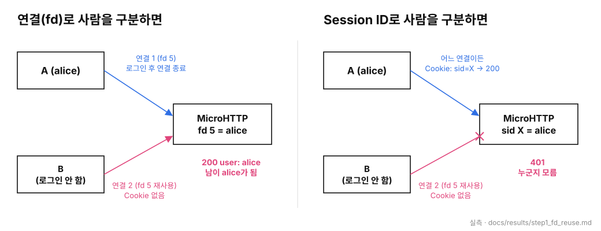
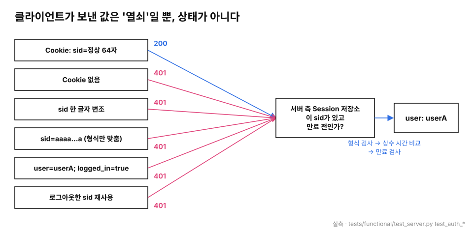
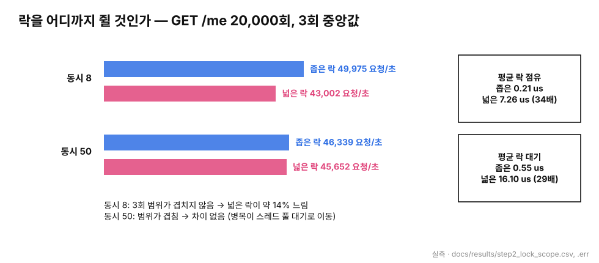

# HTTP는 Stateless인데,<br>서버는 어떻게 나를 기억할까?

**안전하고 끊김 없는 웹 서비스 이용을 위한 설계와 검증**

HTTP는 요청마다 독립적이라, 방금 비밀번호를 확인한 서버도 다음 요청에서는 내가 누구인지 모릅니다.
C와 POSIX 소켓으로 만든 웹 서버에 Cookie · Session 인증을 직접 구현하면서, **Security(안전) · Usability(끊김 없음) · Reliability(믿을 수 있음)** 사이에서 내린 선택을 실험으로 확인했습니다.

> 모든 숫자는 실제로 실행한 결과입니다([docs/results/](docs/results/)). 그림 오른쪽 아래에 **개념도 / 실측**을 표시했습니다.


| 질문 | 선택 | 검증 결과 |
|---|---|---|
| 무엇으로 사람을 알아볼까? | 연결(fd)이 아니라 **Session ID** | fd로 구분하면 남이 alice가 됨 |
| 클라이언트 값을 믿어도 될까? | Cookie에는 **열쇠(ID)만**, 상태는 서버에 | 위조·변조 Cookie 모두 401 |
| 여러 스레드가 같은 Session을 만지면? | 락 안에서 **복사**, 느린 일은 락 밖에서 | 포인터 방식은 UAF, 복사 방식은 0건 |
| 언제 잊고, 서버가 늘면? | Idle·Absolute 만료 / 다중 서버는 비교만 | 요청 없이 6→0개 정리, 서버 2대면 200·401 번갈아 |

---

## 1. 연결이 아니라 Session ID로 기억한다

TCP 연결은 금방 닫히고, 커널은 닫힌 fd 번호를 다음 연결에 바로 다시 줍니다. 일부러 fd로 사용자를 기억하는 서버를 만들어 같은 시나리오를 돌렸습니다.



fd 방식에서는 **아무 자격 증명도 없는 B가 `user: alice`로 인증**됐습니다. 그래서 로그인하면 추측할 수 없는 Session ID를 만들어 `Set-Cookie`로 맡기고, 이후 어떤 연결로 오든 Cookie로 판단합니다.

## 2. 클라이언트가 보낸 값은 열쇠일 뿐



- Session ID: CSPRNG 256비트, 로그인할 때마다 새로 발급(Session 고정 방지), 상수 시간 비교
- 비밀번호: 직접 구현하지 않고 검증된 라이브러리(libsodium argon2id)
- Cookie: `HttpOnly; SameSite=Lax`, 로그에 Session ID를 남기지 않음

## 3. 복사해서 들고 나간다 — Use-After-Free

한 스레드가 응답을 만드는 동안 다른 스레드가 같은 Session을 로그아웃(`free`)하면 어떻게 될까요? 3,000번씩 경쟁시켰습니다.


| | 포인터를 넘기면 | 복사해서 넘기면 |
|---|---|---|
| ASan | heap-use-after-free | 0건 |
| Valgrind | Invalid read 4건 | 0건 |
| TSan | **잡지 못함** | 0건 |

TSan이 깨끗하다고 메모리가 안전한 것은 아니었습니다. 도구를 겹쳐 써야 하는 이유입니다.

## 4. 락은 짧게 쥔다

복사 대신 응답을 보낼 때까지 락을 쥐면 더 간단하지 않을까요?



동시 8에서는 넓은 락이 약 14% 느렸고, 동시 50에서는 차이가 없었습니다(병목이 스레드 풀 대기로 이동). **"차이 없음"도 결과로 기록**했습니다.

## 5. 잊어야 안전하다 — 만료

- **Idle**(마지막 사용 후 30분) · **Absolute**(생성 후 8시간), 만료된 Session은 갱신하지 않음
- 조회할 때 정리(Passive) + 요청이 없어도 1초마다 정리(Active) → 실측: 요청 없이 Session 6개 → 0개


## 6. 프록시 뒤에서, 그리고 서버가 2대가 되면

Reverse Proxy를 거쳐도 Cookie·Set-Cookie가 그대로 전달되어 **직접 접근과 결과가 같았습니다.** 하지만 서버가 2대가 되면 Session이 각 서버의 메모리에 있어서 문제가 생깁니다.


| 해결 방식 (비교만, 구현하지 않음) | 장점 | 단점 |
|---|---|---|
| Sticky Session | 코드 변경 없음 | 서버가 죽으면 로그인 유실 |
| Session Replication | 어느 서버로 가도 됨 | 복제 지연, 통신량 증가 |
| 공유 저장소 (Redis 등) | 서버 확장이 쉬움 | 단일 장애점, 매 요청 네트워크 왕복 |

---

## 기존 서버를 망가뜨리지 않았나

인증을 넣기 전에 기준점을 측정해 두고 같은 방법으로 비교했습니다.

| 검사 | 인증 전 | 인증 후 |
|---|---|---|
| 테스트 (일반 · ASan · TSan) | 28/28 | 34/34 |
| Linux (Valgrind 포함) | 통과 | 통과 |
| 처리량 (같은 시간대 교차 측정) | 35,599 요청/초 | 37,884 요청/초 |

처음에는 따로 측정해서 -31%가 나왔지만, 같은 시간대에 번갈아 재 보니 **측정 환경 차이**였습니다. 숫자보다 비교 방법을 먼저 의심해야 한다는 것을 배웠습니다.

## 한계

- **TLS(HTTPS)와 CSRF 검증은 미완료**입니다. 그래서 Cookie에 `Secure`를 붙이지 못했습니다.
- HTTPS와 Cookie 속성도 **이미 탈취된** Session ID의 재사용은 막지 못합니다.
- Session이 많을 때의 조회 비용, 느린 클라이언트에서의 락 비교는 측정하지 않았습니다.

## 마치며

**연결은 사라지지만, 사람은 남는다.** 로그인은 Stateless 프로토콜 위에 서버가 상태를 얹는 일이었고, 그 대가는 식별 · 신뢰 · 공유 · 수명의 문제였습니다.

---

## 실행

```bash
make server
./server -p 8080 -U tests/functional/users.txt        # 테스트 계정: alice / alice-test-pw
curl -i -c jar -d 'username=alice&password=alice-test-pw' http://127.0.0.1:8080/login
curl -b jar http://127.0.0.1:8080/me                    # → user: alice
make test                                               # 단위 + 기능 테스트
```

C 표준 라이브러리와 POSIX API만 쓰고(비밀번호 해싱만 libsodium), macOS와 Linux에서 빌드됩니다.

| 더 보기 | 내용 |
|---|---|
| [EXPERIMENT_REPORT.md](EXPERIMENT_REPORT.md) | 실험별 목적 · 가설 · 재현 명령어 · 결과 · 해석 |
| [IMPLEMENTATION_REPORT.md](IMPLEMENTATION_REPORT.md) | 기본 과제 달성 현황, 변경 파일, 기술 선택 근거, 미완료 항목 |
| [CODE_FLOW.md](CODE_FLOW.md) | 실제 함수 기준 요청 처리 흐름 (2.4 인증) |
| [STUDY_GUIDE.md](STUDY_GUIDE.md) | 핵심 개념 What · Why · How · Without · Code |
| [QUALITY_REPORT.md](QUALITY_REPORT.md) | 웹 서버 품질 검증 (단위 · 기능 · 부하 · 메모리 · 엣지 케이스) |
