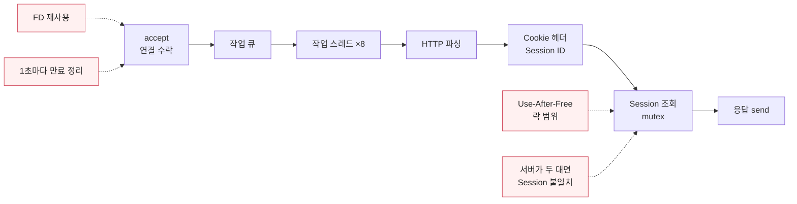
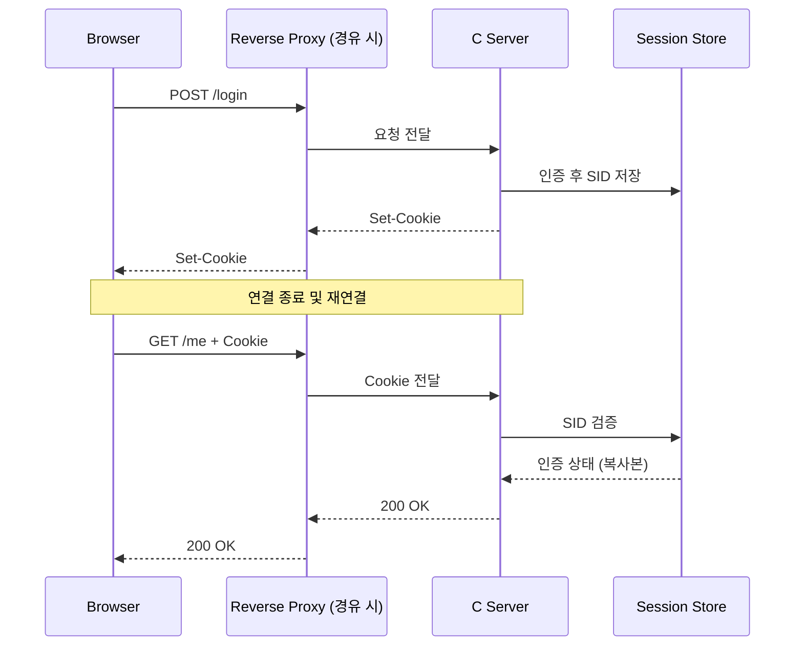
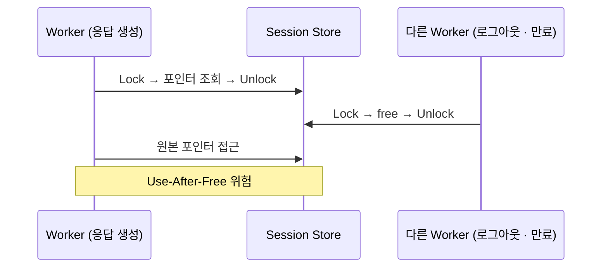
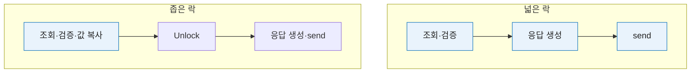
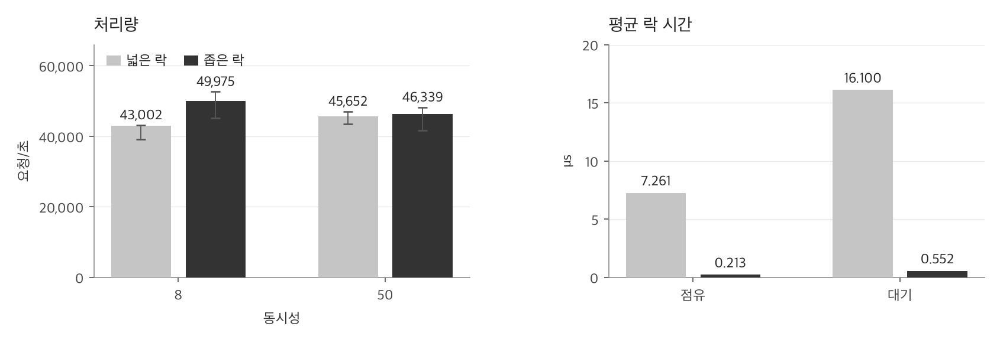
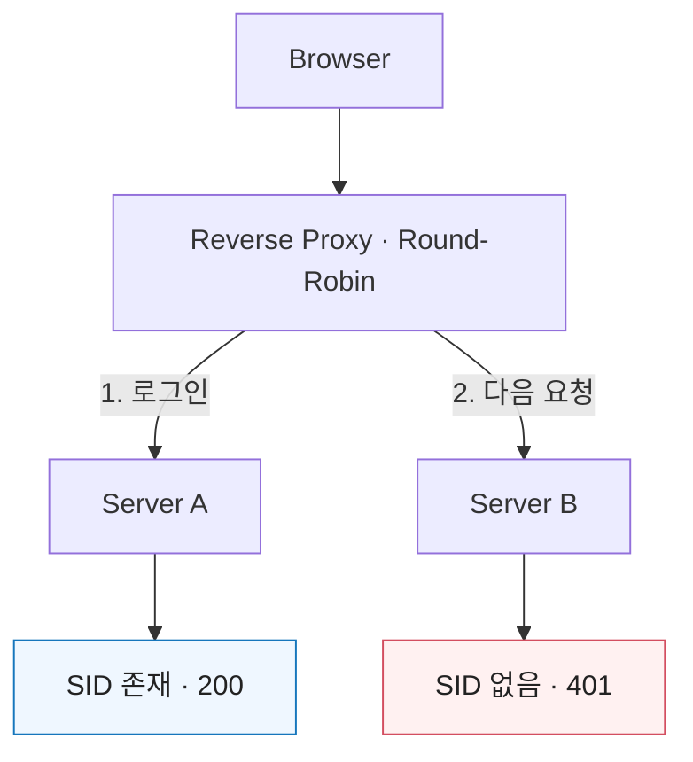
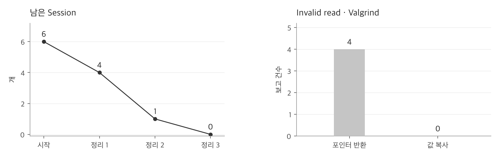

<div align="center">

# HTTP는 Stateless인데,<br>서버는 어떻게 나를 기억할까?

**안전하고 끊김 없는 웹 서비스 이용을 위한 설계와 검증**

C와 POSIX 소켓으로 만든 웹 서버를, **로그인 상태 유지**라는 시나리오로 검증한 프로젝트

`C / POSIX Socket` · `HTTP/1.1` · `Thread Pool` · `Reverse Proxy`

보안성 &nbsp; · &nbsp; 사용성 &nbsp; · &nbsp; 안정성

</div>

## 01. 웹 서버 프로젝트

외부 HTTP 라이브러리 없이 C와 POSIX 소켓만으로 만든 웹 서버다. 소켓 I/O, HTTP 파싱, 라우팅으로 이어지고, 작업 스레드 8개가 요청을 나눠 처리한다.

이 서버가 실제 서비스처럼 동작하는지 확인하려고 **로그인 상태 유지**를 시나리오로 골랐다. 로그인은 연결 수명, HTTP의 Stateless 특성, 스레드 간 공유 메모리, 프록시 뒤의 여러 서버를 한 번에 시험하기 때문이다.

요청 하나가 서버 안을 지나가는 길이다. 연결을 받으면 작업 스레드가 요청을 읽고, 쿠키로 Session을 찾은 뒤 응답을 보낸다.



## 02. 문제 정의

HTTP는 요청마다 독립적이라, 방금 로그인한 사용자도 다음 요청에서는 알아보지 못한다.
**TCP 연결이 끊어져도 로그인은 유지되어야 하지 않을까?**

이 질문은 웹 서버의 세 곳에서 문제가 된다.

1. **소켓과 HTTP** — 연결이 닫히면 FD 번호는 다음 연결에 다시 쓰인다. 그렇다면 사람은 무엇으로 구분하고, 그 정보를 어떤 헤더에 실어 보내야 할까?
2. **타이머와 스레드 풀** — 언제 잊어야 할까? 이벤트 루프 없이 만료는 어디서 정리하고, 로그아웃된 Session을 free하는 순간 다른 스레드가 읽고 있다면?
3. **Reverse Proxy** — 프록시를 거치거나 서버가 두 대가 되어도 같은 사용자로 인식될까?

| 보안성 | 사용성 | 안정성 |
| --- | --- | --- |
| 인증 정보 보호 | 반복 로그인 방지 | 동시 요청에서도 안정적인 응답 |

## 03. 설계 근거

### 소켓 — 연결은 사라지고 번호는 재사용된다

| 대안 | 판단 |
| --- | --- |
| Socket FD | 연결 종료와 번호 재사용에 종속 |
| 검증 없는 사용자 정보 Cookie | 클라이언트 변조 위험 |
| 서버 측 Session | 연결과 독립적인 인증 및 권한 무효화 가능 |

가장 먼저 떠오른 식별자는 소켓 FD였다. 하지만 커널은 닫힌 FD 중 **가장 작은 번호를 다음 연결에 바로 다시 준다.** FD로 사람을 구분하면, 다른 사람이 같은 번호를 물려받을 수 있다

그래서 서버 측 Session을 택했다. Session은 TCP 연결이 아니라 **쿠키에 담긴 Session ID**로 사용자를 구분하므로, 연결이 끊겨도 로그인이 유지된다.



Session ID는 예측할 수 없는 256비트 난수로 만들고, 로그인할 때마다 새로 발급한다. 로그아웃하면 서버에서도 그 ID를 무효화한다.

### HTTP와 타이머 — 요청이 없는 동안 서버는 무엇을 하나

만료 시간이 짧으면 재로그인이 잦고, 길면 유출된 ID가 오래 쓰인다.

| 만료 정책 | 판단 |
| --- | --- |
| 고정 만료 | 이용 중에도 로그아웃 가능 |
| 유휴 만료 | 반복 요청으로 무기한 연장 가능 |
| **Idle + Absolute Timeout** | 이용 중 갱신하되 최대 인증 기간 제한 |

**서버는 만료를 어떻게 처리하나** — 요청이 오면 그 Session의 만료를 먼저 검사하고(Passive), 요청이 없어도 1초마다 정리한다(Active). 이 서버는 이벤트 루프가 없는 스레드 풀 구조라, 이미 1초마다 깨어나는 accept 루프의 `poll`을 정리 타이머로 썼다.

**구현하고 나서 알게 된 것** — Idle Timeout은 **요청이 들어올 때만** 갱신된다.

## 04. 스레드 풀 — 공유 메모리를 동시에 지울 때

만료된 Session은 접근 시 삭제하는 것만으로는 충분하지 않다. 요청이 없는 상태에서도 주기적으로 정리해야 한다. 이 서버에는 이벤트 루프가 없으므로, 이미 1초마다 깨어나는 연결 수락 루프를 정리 타이머로 썼다. 그런데 삭제와 요청 처리가 겹치면 어떻게 될까?





원본 포인터를 넘기지 않고 필요한 값을 락 내부에서 복사한다. 응답 생성과 전송은 임계 영역 밖에서 처리한다. 메모리 안전성을 확보하면서 다른 요청의 대기 시간을 줄일 수 있는지 검증한다.

## 05. 데모

```bash
sh demo.sh      # 엔터를 누를 때마다 다음 단계 (실행 시간 약 8초)
```

| 단계 | 보여 주는 것 | 결과 |
| --- | --- | --- |
| ① HTTP · Cookie | 로그인 → 새 TCP 연결로 `/me` → Cookie 없이 · 위조 Cookie로 `/me` | 303 + `Set-Cookie` → 200 `user: userA` → 401 · 401 |
| ② 소켓 · FD 재사용 | 같은 시나리오를 Session 방식과 FD 방식 서버에 실행 | 로그인하지 않은 B: Session 방식 401 / **FD 방식은 B를 `userA`로 착각** |
| ③ 스레드 풀 · UAF | 조회 결과를 포인터로 넘기는 버전과 복사하는 버전 | 포인터: **ASan heap-use-after-free** / 복사: 0건 |
| ④ 검증 | Session 단위 테스트, 인증 기능 테스트 | **PASS**, 6/6 |

FD 방식에서 B는 비밀번호도 쿠키도 보내지 않았는데, 커널이 닫힌 FD 5를 B에게 다시 주자 서버는 B를 `userA`로 착각했다. 데모 화면의 서버 로그에서 세 연결이 모두 같은 fd 5를 받은 것을 확인할 수 있다.

## 06. 검증

**① 테스트와 메모리 검사** — 단위 · 기능 테스트와 새니타이저 3종을 모두 통과했다.

| 단계 | 규모 | 결과 |
| --- | --- | --- |
| 단위 테스트 (HTTP 파서 · MIME · 라우팅 · Session 저장소) | 6개 파일 | 모두 통과 |
| 기능 테스트 (실제 TCP 요청, 인증 6개 포함) | 34개 | 34/34 |
| 메모리 · 동시성 (ASan · TSan · Valgrind) | 3종 | 개선 코드 0건 |
| 회귀 (인증 추가 전후) | 28 → 34 | 기능 · 성능 회귀 없음 |

**② 예상과 다른 결과** — 두 가지가 예상과 달랐다.

- **TSan은 UAF를 잡지 못했다.** 포인터 방식의 UAF를 ASan과 Valgrind(Invalid read 4건)는 잡았지만 TSan은 아무것도 보고하지 않았다. 도구 하나가 깨끗하다고 안전한 것은 아니어서, 세 도구를 함께 썼다.
- **좁은 락의 효과는 동시성 8에서만 보였다.** 동시성 50에서는 차이가 없었다. 연결 50개가 작업 스레드 8개를 기다리는 동안 락 대기는 그 대기에 묻혔고, 병목이 락에서 스레드 풀로 옮겨 갔다.

| `GET /me` 20,000회, 3회 중앙값 | 넓은 락 | 좁은 락 |
| --- | --- | --- |
| 처리량 (동시 8) | 43,002 요청/초 | **49,975 요청/초** |
| 처리량 (동시 50) | 45,652 요청/초 | 46,339 요청/초 |
| 평균 락 점유 | 7.26 µs | 0.21 µs |



**③ 테스트로 발견한 문제**

| 발견한 방법 | 문제 | 조치 |
| --- | --- | --- |
| 단위 테스트 | 헤더 이름 비교가 한쪽만 소문자로 바꿔 `Cookie` 헤더를 찾지 못함 | 양쪽 모두 소문자로 비교 |
| TSan 첫 실행 | 시그널 핸들러와 작업 스레드가 셧다운 플래그에 동시에 접근하는 데이터 레이스 | `atomic_int`로 변경 |
| 엣지 케이스 | 1바이트씩 천천히 보내는 요청(Slowloris)이 스레드를 무기한 점유 | 요청 총 한도 10초 → 408 |
| Valgrind 서버 실행 | 프록시가 이미 떠난 클라이언트를 위해 스레드를 5초씩 점유 | 클라이언트 연결도 함께 감시 |

회귀 테스트를 추가한 수정은 모두 **수정 전 코드에서 테스트가 실패하는 것을 먼저 확인**했다. 테스트가 우연히 통과하는 것이 아님을 보장하기 위해서다.

## 07. 결과 및 한계

### 결과 — 무엇을 검증했는가?

| 핵심 가치 | 검증 항목 | 결과 |
| --- | --- | --- |
| 보안성 | Cookie 변조·만료·로그아웃 이후 인증 거부 | 모두 401 |
| 사용성 | TCP 재연결 이후 로그인 유지 | 새 연결 3개 모두 200 |
| 사용성 | 활동 기반 만료 갱신 및 최대 유지 시간 제한 | Idle 갱신 · Absolute 만료 · 만료 후 갱신 금지 단위 테스트 통과 |
| 안정성 | 만료 Session 회수 및 UAF 방지 | 6 → 0개 회수, 복사 방식 메모리 오류 0건 |
| 안정성 | 임계 영역 최소화에 따른 성능 변화 | 동시 8에서 처리량 +16%(넓은 락은 -14%), 동시 50에서 차이 없음 |
| 안정성 | Proxy 경유 인증 및 기존 기능 회귀 검증 | 직접 접근과 동일, 테스트 28/28 → 34/34, 처리량 회귀 없음 |

### Reverse Proxy — 서버가 두 대가 되면



서버를 두 대로 늘려 Round-Robin 뒤에 두고, 로그인한 뒤 같은 Cookie로 `/me`를 6번 요청하자 **200, 401, 200, 401, 200, 401**이 나왔다. 서버별 Session 저장소가 독립적이라 정상적으로 로그인한 사용자도 다른 서버에서 인증에 실패한다.

### 대안에도 한계가 존재한다

| 대안 | 이점 | 비용 및 한계 |
| --- | --- | --- |
| 인메모리 Session | 서버 측 즉시 무효화 | 서버 간 상태 공유 필요 |
| JWT | 호환되는 키와 정책으로 독립적인 인증 검증 | 즉시 무효화에 추가 정책 필요 |
| Redis + Session | 공통 상태 조회 및 무효화 | 외부 저장소 의존성·네트워크 I/O |

JWT는 별도의 무효화 정책이 없다면 로그아웃 이후에도 기존 토큰을 만료 전까지 사용할 수 있다. JWT와 Redis는 설계 대안이며 구현 범위에는 포함하지 않는다.

**남아 있는 문제**

- 유출된 유효 Session ID의 재사용 위험 — HTTPS(TLS)는 범위에서 제외했고, HTTPS여도 이미 유출된 ID의 재사용은 막지 못한다
- 서비스에 적합한 TTL 설정값의 정량적 근거 부족
- 다중 서버 환경의 인증 상태 공유

### 결론

로그인 하나를 붙였을 뿐인데, 웹 서버의 연결 수명, HTTP의 Stateless 특성, 스레드 간 공유 메모리, 프록시 뒤의 여러 서버가 모두 문제로 드러났다.

사용자를 기억하는 것만으로 충분하지 않다. 언제 인증 권한을 종료하고, 어떻게 안전하게 자원을 회수하며, 다른 사용자의 요청에 미치는 영향을 줄일지까지 고려해야 한다.

**기술 선택은 기술 자체의 우수성이 아니라 서비스의 요구사항과 Trade-off에 의해 결정된다.**

---

<details>
<summary>상세 검증 항목 및 회귀 테스트</summary>

| 항목 | 비교 조건 | 결과 |
| --- | --- | --- |
| TCP / FD | 새 연결, FD 재사용 데모, Cookie 없음 | 새 연결 200 · FD 데모에서 B를 userA로 착각 · Cookie 없음 401 |
| 인증 정보 | 정상·변조·없는 ID 및 유효 ID 재사용 | 정상 200 · 변조 · 없는 ID 401 · 로그인 시 재발급 후 이전 ID 401 |
| 전송 보안 | HTTP/HTTPS, Cookie 속성, CSRF | `HttpOnly; SameSite=Lax` 적용 · **HTTPS · CSRF 미완료(범위 제외)** · `Secure` 미적용 |
| 만료 | Idle/Absolute, 갱신, 로그아웃 | 단위 테스트 통과 · 로그아웃 후 401 |
| 메모리 | 능동·수동 만료 전후 개수 | 요청 없이 6 → 0, 조회 시 만료 삭제 |
| 동시성 | UAF 재현 및 개선, ASan/TSan 등 | 포인터: ASan · Valgrind 검출, TSan 미검출 / 복사: 0건 |
| 성능 | 락 대기·점유 시간, 평균/p95/p99, 처리량 | 아래 성능 표 |
| Proxy | Cookie/Set-Cookie, no-store, 직접/경유 | 모든 항목 동일, 로그에 Session ID 0건 |
| 다중 서버 | A 로그인 후 B 인증 | A 200 · B 401 |

| 검증 질문 | 결과 |
| --- | --- |
| 재연결 이후에도 인증되는가? | 로그인한 연결을 닫은 뒤 새 TCP 연결 3개 모두 200 |
| 변조·만료·로그아웃된 인증 정보가 거부되는가? | 한 글자 변조 · 형식만 맞춘 ID · `logged_in=true` 위조 Cookie · 만료 · 로그아웃 후 ID 모두 401 |
| 요청 없이도 만료 Session이 정리되는가? | 요청 없이 6 → 4 → 1 → 0개, 이후 401 |
| UAF가 재현되고 개선 코드에서 오류가 검출되지 않는가? | 포인터 방식: ASan heap-use-after-free, Valgrind Invalid read 4건 / 복사 방식: 0건 |
| Reverse Proxy를 경유해도 인증되는가? | 로그인 · 재인증 · 로그아웃 · Cookie 속성 · `no-store` 모두 직접 접근과 동일 |



`GET /me` 20,000회, keep-alive, 3회 중앙값:

| 성능 지표 | 넓은 락 | 좁은 락 |
| --- | --- | --- |
| Throughput (동시 8) | 43,002 요청/초 | 49,975 요청/초 |
| Throughput (동시 50) | 45,652 요청/초 | 46,339 요청/초 |
| p95 / p99 (동시 8) | 0.3 / 0.6 ms | 0.3 / 0.5 ms |
| p95 / p99 (동시 50) | 0.3 / 3.4 ms | 0.3 / 3.1 ms |
| 오류율 | 0% | 0% |
| 평균 락 점유 / 대기 | 7.26 / 16.10 µs | 0.21 / 0.55 µs |

| 회귀 검증 | 변경 전 | 변경 후 |
| --- | --- | --- |
| LMS 테스트 (일반 · ASan · TSan) | 28/28 | 34/34 |
| 처리량 (같은 시간대 교차 측정) | 35,599 요청/초 | 37,884 요청/초 |
| 메모리 안전성 (ASan · TSan · Valgrind) | 통과 | 통과 |

처음에는 변경 전후를 따로 측정해 처리량이 **-31%**로 나왔다. 정적 경로에 추가된 것은 문자열 비교 3번뿐이라 이상했고, 두 바이너리를 같은 시간대에 번갈아 측정하자 차이가 사라졌다. -31%는 회귀가 아니라 **측정 시점의 환경 차이**였다.

Sticky Session은 장애·부하 편중, Session Replication은 동기화 비용을 고려해야 한다. JWT도 서명 검증만으로 탈취를 막을 수 없다.

재현 명령과 원시 결과: [EXPERIMENT_REPORT.md](EXPERIMENT_REPORT.md) · [docs/results/](docs/results/)

원시 기록은 계정 이름을 `alice`/`bob`에서 `userA`/`userB`로 바꾸기 전에 실행한 출력이라 옛 이름이 남아 있다.

</details>

*모든 결과는 실제 실행 기록이다 · 01·03·04·07의 다이어그램은 개념도*
