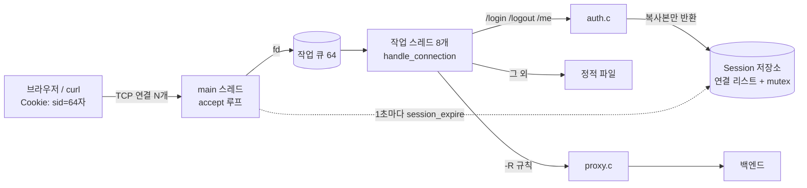
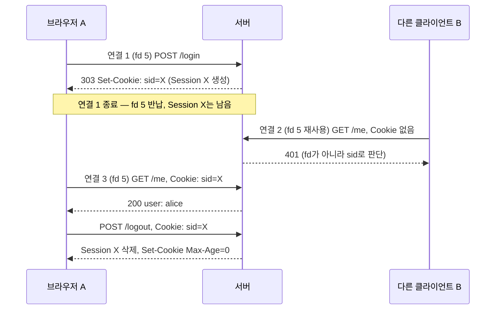

# MicroHTTP — C로 만드는 학습용 웹 서버

## 기본 과제 달성 현황 (STEP 0 베이스라인, 2026-11-25)

인증 기능을 넣기 **전** 상태입니다. 베이스라인에서 발견한 TSan 레이스 1건은 STEP 1 전에 고쳤고, 표는 수정 후 상태입니다(성능은 수정 전후 차이 없음). 이후 모든 비교와 회귀 검증의 기준점입니다. 측정 방법과 원시 결과는 [EXPERIMENT_REPORT.md](EXPERIMENT_REPORT.md) STEP 0에 있습니다.

| 영역 | LMS 체크리스트 항목 | 상태 | 근거 (코드 / 테스트) |
|---|---|---|---|
| 소켓 | `socket → bind → listen → accept`, `SO_REUSEADDR`, bind 실패 처리 | ✅ | `server.c` `create_listener`, `main` |
| 소켓 | 블로킹 + 타임아웃(클라이언트), 논블로킹 connect + poll(백엔드) | ✅ | `net.c` `set_socket_timeout`, `connect_with_timeout` |
| HTTP | 요청 줄·헤더·본문 경계, `Content-Length`, GET/POST | ✅ | `http.c` `http_parse_request`, `test_http.c` |
| HTTP | keep-alive, 파이프라이닝, 연결당 100요청, 유휴 5초 | ✅ | `server.c` `handle_connection`, 기능 테스트 4개 |
| HTTP | 정적 파일, MIME, 404/403/500, 경로 탈출 방지 | ✅ | `static_file.c`, `test_static.c`, `test_mime.c` |
| HTTP | 오류 응답 400/408/411/413/414/417/431/501/505 | ✅ | `test_http.c`, `edge_probe.py` 30케이스 |
| 동시성 | 스레드 풀(기본 8) + 작업 큐(64) + 배압 | ✅ | `server.c` `queue_push`/`queue_pop`/`worker_main` |
| 동시성 | SIGINT/SIGTERM 안전한 셧다운, SIGPIPE 무시 | ✅ | `test_graceful_shutdown_…`. 베이스라인에서 TSan이 `stop_requested` 데이터 레이스를 보고 → C11 `atomic_int`로 수정 (EXPERIMENT_REPORT STEP 0-1) |
| Proxy | Reverse Proxy, 경로 라우팅(최장 prefix), Round-Robin | ✅ | `proxy.c`, `test_proxy.c` |
| Proxy | 502(연결 불가)/504(타임아웃), 장애 백엔드 건너뛰기, 떠난 클라이언트 감지 | ✅ | 기능 테스트 10개 |
| Proxy | Forward Proxy | ➖ | 요구사항은 "최소 한 가지" — Reverse Proxy 선택 |
| 메모리·안정성 | ASan + UBSan | ✅ | `make asan` 단위 6 + 기능 34/34 (인증 추가 후) |
| 메모리·안정성 | ThreadSanitizer | ✅ | `make tsan` 기능 34/34 (인증 추가 후, macOS). 베이스라인은 27/28 → 레이스 수정 후 28/28 |
| 메모리·안정성 | Valgrind(누수·잘못된 접근), 일반 사용자 테스트, malloc 실패 → 500 (Linux) | ✅ | `tests/linux/verify.sh` → `ALL LINUX CHECKS PASSED` |
| 메모리·안정성 | fd 누수 | ✅ | 부하 측정 전후 fd 7 → 7, Valgrind `--track-fds` 종료 시 stdio + 로그만 열림 |
| 메모리·안정성 | 엣지 케이스(불완전 헤더, Slowloris, 큰 본문, 긴 URI, 백엔드 타임아웃, 갑작스러운 종료) | ✅ | `edge_probe.py` 30/30, 기능 테스트 34/34 |

**베이스라인 성능** (hey, 3회 중앙값, M1 Pro 루프백, 작업 스레드 8)

| 시나리오 | 요청/초 | p95 ms | p99 ms | 비정상 응답 |
|---|---:|---:|---:|---:|
| 정적 `GET /`, keep-alive, 동시 8 | 37,700 | 0.3 | 0.6 | 0 |
| 정적, keep-alive, 동시 50 | 39,471 | 0.3 | 4.7 | 0 |
| 정적, 요청마다 새 연결, 동시 10 | 18,248 | 0.9 | 1.2 | 0 |
| 정적, 요청마다 새 연결, 동시 50 | 19,096 | 4.4 | 5.3 | 0 |
| 프록시 `GET /api/x`, 동시 10 | 5,365 | 2.2 | 2.9 | 0 |


외부 HTTP 라이브러리 없이 POSIX 소켓 API만으로 만든 HTTP/1.1 웹 서버입니다.
구현 범위는 [REQUIREMENTS.md](REQUIREMENTS.md), 작업 원칙은 [CLAUDE.md](CLAUDE.md)를 따릅니다.

---

# 인증 상태 관리 — HTTP는 Stateless인데, 서버는 어떻게 나를 기억할까?

> 로그인이라는 일상적인 경험에서 출발해, Cookie와 서버 측 Session을 직접 구현하며 **Security · Usability · Reliability** 사이의 선택을 실험으로 확인했습니다.
> 상세 기록: [EXPERIMENT_REPORT.md](EXPERIMENT_REPORT.md) · 구현과 선택 근거: [IMPLEMENTATION_REPORT.md](IMPLEMENTATION_REPORT.md) 10절 · 호출 흐름: [CODE_FLOW.md](CODE_FLOW.md) 2.4 · 개념 정리: [STUDY_GUIDE.md](STUDY_GUIDE.md) 13~16

## 전체 아키텍처 (개념도)



## TCP 연결과 Session의 생명주기 (개념도)



## STEP별 기록 — 문제 → 가설 → 선택 → 구현 → 실험 → 결과 → 새 문제

| STEP | 문제 | 가설 / 선택 | 구현 | 실험 결과 (실측) | 새 문제 |
|---|---|---|---|---|---|
| 0 베이스라인 | 인증을 넣은 뒤 "느려졌나, 깨졌나"를 판단할 기준이 없음 | 같은 스크립트로 전후 측정 | `tests/bench/baseline.sh` | 5개 시나리오 비정상 0. **TSan 첫 실행에서 `stop_requested` 데이터 레이스 발견 → atomic_int로 수정** | 측정 변동 최대 약 10% |
| 1 TCP ≠ Session | 로그인 상태를 무엇에 묶을까 | 연결(fd)이 아니라 Cookie의 Session ID | `session.c`, `auth.c` | fd 식별 데모: **자격 증명 없는 B가 `user: alice`**. Session 방식: B는 401, A는 새 연결 3개에서 200 | 만료, 동시 접근 |
| 2 만료·동시성 | 버려진 Session, 로그아웃과 조회의 경쟁 | Passive+Active 만료, **락 안에서 복사** | `session_lookup` 복사본, 1초 주기 `session_expire` | 요청 없이 6→0개 정리. **포인터 반환 시 ASan UAF·Valgrind Invalid read 4, 복사본 0**. 넓은 락은 c=8에서 -14%, 락 점유 34배 | TSan은 UAF를 못 잡음 |
| 3 Proxy 경유 | 프록시가 Cookie를 망가뜨리지 않나 | 기존 프록시 그대로(캐시 없음) | 변경 없음, 백엔드가 no-store | 직접과 경유가 로그인·/me·로그아웃·속성·no-store 모두 동일 | 프록시는 연결을 닫음(keep-alive 아님) |
| 4 입력 불신 | 클라이언트가 보낸 상태를 믿으면? | 서버 측 저장, CSPRNG ID, 재발급, argon2id | libsodium | 위조·변조·형식만 맞춘 ID, `logged_in=true` Cookie 모두 401 | 없는 사용자는 응답이 빨라 존재 여부가 드러날 수 있음 |
| 5 노출·전송 | ID가 새는 경로 | HttpOnly, SameSite=Lax, 로그 미기록 | `COOKIE_ATTRIBUTES` | 로그의 ID 평문 0건 | **TLS·CSRF 검증 미완료**, Secure 미적용 |
| 7 다중 서버 | 서버가 2대면? | 메모리 저장소의 한계 확인 | 실험만 | A에서 받은 sid: A 200 / B 401. Round-Robin 뒤에서 200·401 번갈아 | Sticky / 복제 / 공유 저장소 비교(아래) |

## 실험 결과 요약 (실측, 재현 명령어)

| 실험 | 명령어 | 핵심 결과 |
|---|---|---|
| FD 재사용 | `make server build/server_fd_demo && python3 tests/experiments/step1_fd_reuse.py` | fd 방식에서 B가 alice로 인증, Session 방식은 401 |
| 만료 | `./server -U tests/functional/users.txt -I 3` 후 로그인 6번 | 요청 없이 `expired 2 → 3 → 1, remaining 0` |
| UAF | `make build/step2_uaf CFLAGS='-O1 -g -fsanitize=address' LDFLAGS=-fsanitize=address && build/step2_uaf unsafe` | unsafe: heap-use-after-free / safe: 0 |
| 락 범위 | `sh tests/bench/step2_lock_scope.sh 3` | 아래 표 |
| 프록시 경유 | `sh tests/experiments/step3_proxy_auth.sh` | 직접 = 경유 |
| 서버 2대 | `sh tests/experiments/step7_two_servers.sh` | 200 / 401 |
| Linux 전체 | `docker build -t microhttp-verify tests/linux && docker run --rm -v "$PWD":/src:ro microhttp-verify sh /src/tests/linux/verify.sh` | `ALL LINUX CHECKS PASSED` |

**락 범위 비교 (실측, `GET /me` 20,000회, 3회 중앙값)**

| 변형 | 동시 8 요청/초 | 동시 50 요청/초 | 평균 락 점유 | 평균 락 대기 |
|---|---:|---:|---:|---:|
| 좁은 락 (복사 후 해제) | 49,975 | 46,339 | 0.21 us | 0.55 us |
| 넓은 락 (send까지) | 43,002 | 45,652 | 7.26 us | 16.10 us |

동시 8은 3회 범위가 겹치지 않아 차이가 있고, 동시 50은 겹쳐서 차이가 없다고 판단했습니다(병목이 스레드 풀 대기로 옮겨 감).

**회귀 (STEP 0 대비, 실측)**

| 시나리오 | STEP 0 (레이스 수정 후) | 인증 추가 후 | 중앙값 변화 | 3회 범위 | 비정상 |
|---|---:|---:|---:|---|---:|
| 정적 keep-alive c8 | 42,445 | 29,326 | -30.9% | 안 겹침 | 0 → 0 |
| 정적 keep-alive c50 | 40,298 | 34,352 | -14.8% | 안 겹침 | 0 → 0 |
| 정적 새 연결 c10 | 19,894 | 18,634 | -6.3% | 겹침 | 0 → 0 |
| 정적 새 연결 c50 | 19,011 | 18,987 | -0.1% | 겹침 | 0 → 0 |
| 프록시 c10 | 5,774 | 5,198 | -10.0% | 겹침 | 0 → 0 |

keep-alive의 큰 하락이 실제 회귀인지 확인하려고, **두 바이너리(STEP 0 `73dc4dd`, 현재)를 같은 시간대에 번갈아 6회씩** 측정했습니다(`docs/results/step2_ab_static.csv`):
STEP 0 중앙값 **35,599** · 현재 **37,884** 요청/초 — 짝지은 6쌍 중 5쌍에서 현재가 같거나 빠름. 같은 세션 안에서 두 바이너리 모두 31k→40k로 함께 움직였으므로(측정 시 load average 약 3),
위 -31%는 두 측정 시점 사이의 환경 변화이고 **회귀는 없다**고 판단합니다. 정적 경로에 추가된 것은 경로 문자열 비교 3번뿐입니다.
기능·메모리 회귀: `make test`/`asan`/`tsan` 모두 단위 6 + 기능 34/34, Linux `verify.sh` ALL PASSED(Valgrind 단위 6개·실서버·인증 흐름 포함). fd는 7 → 9로 시작값이 늘었지만 측정 전후 9 → 9로 일정(libsodium 초기화가 여는 fd로 추정, 누수 아님).

## TTL 트레이드오프 (개념 설명, 실측 아님)

TTL이 짧을수록 탈취된 ID의 유효 시간이 줄지만(Security) 자주 다시 로그인해야 합니다(Usability). 아래는 방향만 정리한 표이며, 특정 값이 최적이라고 주장하지 않습니다.

| 서비스 성격 | Idle TTL 방향 | Absolute TTL 방향 | 이유 |
|---|---|---|---|
| 금융·공공(예: 고용24) | 짧게 (분 단위, 연장 버튼) | 짧게 | 피해가 크고 공용 PC 사용이 많음. 고용24는 화면에 남은 시간과 연장 버튼을 보여 주는 UI 사례로만 참고(내부 구현·최적성은 미확인) |
| 사내 업무 도구 | 중간 (수십 분) | 근무 시간 수준 | 보안과 업무 흐름의 균형 |
| 커뮤니티·쇼핑 | 길게 | 길게 (+ 중요 작업 시 재인증) | 재로그인 피로가 이탈로 이어짐 |
| 이 서버 기본값 | 30분 (`-I 1800`) | 8시간 (`-A 28800`) | 실험용 기본값, 근거 측정 없음 |

## 다중 서버에서의 Session (비교만, 구현하지 않음)

| 방식 | 장점 | 단점 |
|---|---|---|
| Sticky Session | 서버 코드 변경 없음 | 그 서버가 죽으면 로그인 유실, 부하 쏠림 |
| Session Replication | 어느 서버로 가도 됨 | 복제 지연·충돌, 통신량 증가 |
| 공유 저장소(Redis 등) | 서버가 상태를 갖지 않아 확장 쉬움 | 저장소가 단일 장애점, 요청마다 네트워크 왕복 |

## 한계와 미완료 항목

| 항목 | 상태 |
|---|---|
| **TLS**(HTTPS 종료), HTTP vs HTTPS 비교, 탈취 ID 재사용 실험 | 미완료 — 방식 결정·검증 시간 부족. 프록시~백엔드 구간은 평문 |
| **CSRF** 보호 범위 검증 | 미완료 — SameSite=Lax만 적용, 토큰·교차 사이트 실험 없음 |
| Cookie `Secure` | 미적용 — HTTP만 지원하므로 붙이면 브라우저가 Cookie를 보내지 않음 |
| STEP 6 TTL 개념도(그림) | 미완료 — 위 표로 대신 |
| 느린 클라이언트에서의 락 범위 비교 | 미실행 |
| Session이 많을 때 연결 리스트 조회 비용 | 미측정 (성능 측정은 Session 1개 상태) |
| 로그인 실패 타이밍 | 없는 사용자는 해시 검증을 건너뛰어 응답이 빠름 |
| HTTPS와 Cookie 속성의 한계 | 이미 탈취된 Session ID의 재사용은 막지 못함 |
| 4분 발표 | 이 저장소 밖 — 구성: 문제 제기 → STEP 2 실험(UAF, 락 범위) → 남은 문제 |

### 실행 예

```bash
make server build/hashpw
./server -p 8080 -U tests/functional/users.txt          # 테스트 계정: alice / alice-test-pw
curl -i -c jar -d 'username=alice&password=alice-test-pw' http://127.0.0.1:8080/login
curl -b jar http://127.0.0.1:8080/me
```


| 문서 | 내용 |
|---|---|
| [CODE_FLOW.md](CODE_FLOW.md) | 서버 실행부터 종료까지, 연결부터 응답까지의 함수 호출 순서 |
| [STUDY_GUIDE.md](STUDY_GUIDE.md) | 핵심 개념 12개를 What/Why/How/Without/Code로 정리 + 확인 질문 |
| [IMPLEMENTATION_REPORT.md](IMPLEMENTATION_REPORT.md) | 요구사항별 구현 상태, 테스트 명령어와 실제 결과, 한계 |
| [QUALITY_REPORT.md](QUALITY_REPORT.md) | 품질 기준(단위·기능·부하·메모리·엣지 케이스)별 검증 결과와 발견·수정한 결함 |
| [EXPERIMENT_REPORT.md](EXPERIMENT_REPORT.md) | 인증 과제 실험 기록 (STEP 0 베이스라인부터) |

## 빌드와 실행

```sh
make
./server -p 8080 -r ./www
```

브라우저에서 <http://127.0.0.1:8080/>을 엽니다. 종료는 Ctrl+C입니다.

| 옵션 | 의미 | 기본값 |
|---|---|---|
| `-p port` | 리스닝 포트 | 8080 |
| `-r root` | 정적 파일 루트 디렉터리 | `./www` |
| `-t threads` | 작업 스레드 수 (스레드 풀) | 8 |
| `-R prefix=host:port[,host:port...]` | Reverse Proxy 규칙 (여러 번 지정 가능) | 없음 |
| `-b address` | 바인딩할 IPv4 주소 | `127.0.0.1` |
| `-v` | 파서/수신 상세 로그 | 끔 |

## Reverse Proxy 실습

```sh
python3 tools/backend.py 9001 A &     # 실습용 백엔드 (Python 표준 라이브러리)
python3 tools/backend.py 9002 B &
./server -R /api/=127.0.0.1:9001,127.0.0.1:9002
curl http://127.0.0.1:8080/api/hello  # A, B가 번갈아 응답 (Round-Robin)
```

`/api/`로 시작하는 요청은 백엔드로 전달하고, 나머지는 정적 파일로 응답합니다.
연결할 수 없는 백엔드는 건너뛰며, 모두 실패하면 502, 응답이 5초 동안 없으면 504입니다.

## 테스트

```sh
make test   # 단위 테스트(tests/unit) + 기능 테스트(tests/functional)
make asan   # AddressSanitizer/UBSan 빌드로 전체 테스트
sh tests/functional/curl_check.sh   # curl로 정적 파일·프록시 확인
python3 tests/functional/edge_probe.py <port>   # 떠 있는 서버에 엣지 케이스 30개 (사용법은 파일 머리말)
docker build -t microhttp-verify tests/linux && docker run --rm -v "$PWD":/src:ro microhttp-verify sh /src/tests/linux/verify.sh   # Linux: 일반 사용자 테스트, Valgrind, malloc 실패 주입
```

## 소스 구조

| 파일 | 역할 |
|---|---|
| `src/server.c` | main, 리스너, 스레드 풀(작업 큐), 시그널 셧다운, 연결 처리(keep-alive), 요청 처리 |
| `src/http.c` | HTTP 요청 파서, 응답 헤더 생성 (소켓 I/O 없음) |
| `src/static_file.c` | 루트 안에서 파일 찾기(403/404), MIME 타입 매핑 |
| `src/proxy.c` | Reverse Proxy: 경로 라우팅, Round-Robin, 요청 재작성, 응답 중계, 502/504 |
| `src/session.c` | 서버 측 Session 저장소: 생성·조회(복사본)·삭제·만료, mutex 하나 |
| `src/auth.c` | `/login`·`/logout`·`/me`, Cookie·폼 파싱, 비밀번호 확인(libsodium) |
| `src/net.c` | `send_all`, 소켓 타임아웃, 타임아웃 있는 connect, 오류 응답 송신 |
| `tools/backend.py` | 프록시 실습용 백엔드 (테스트 도구) |
