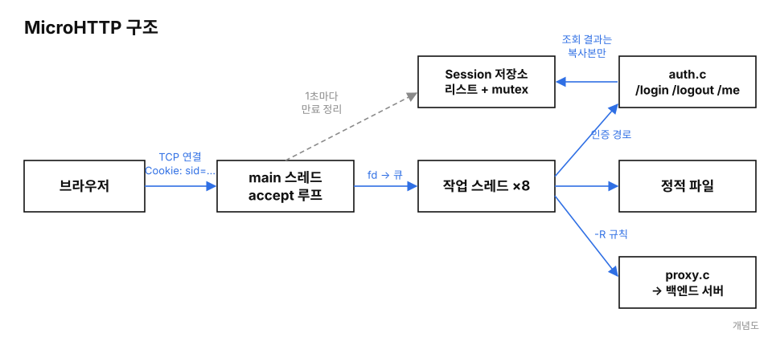
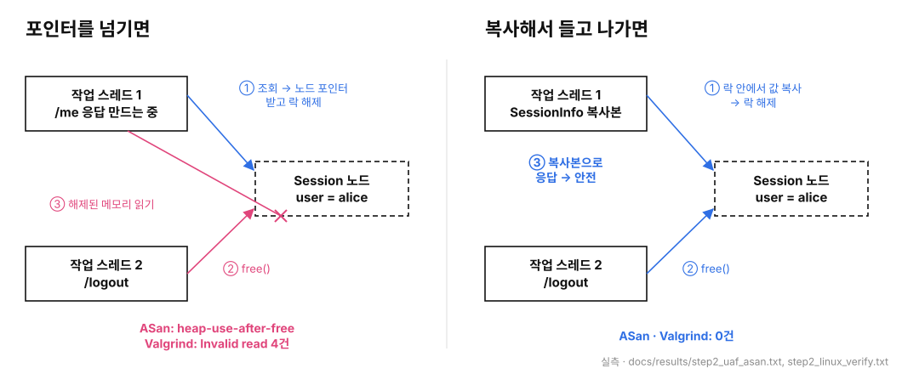
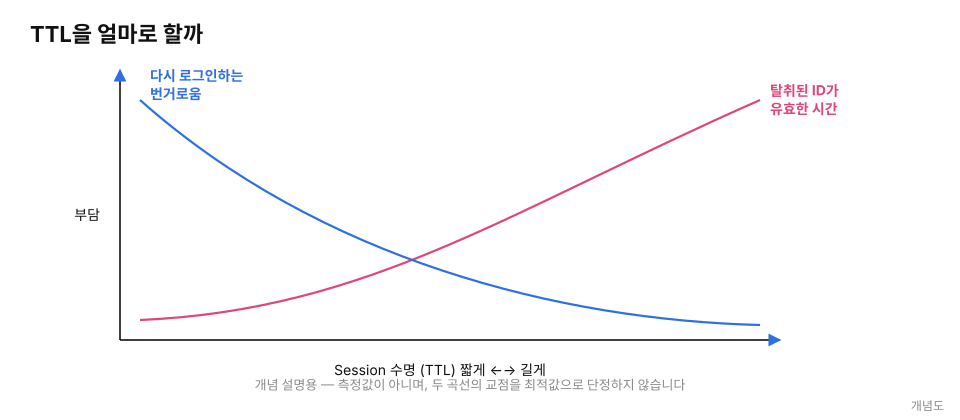
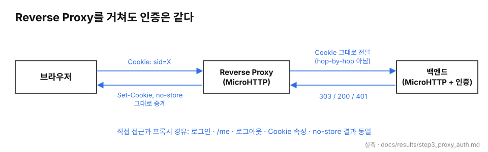
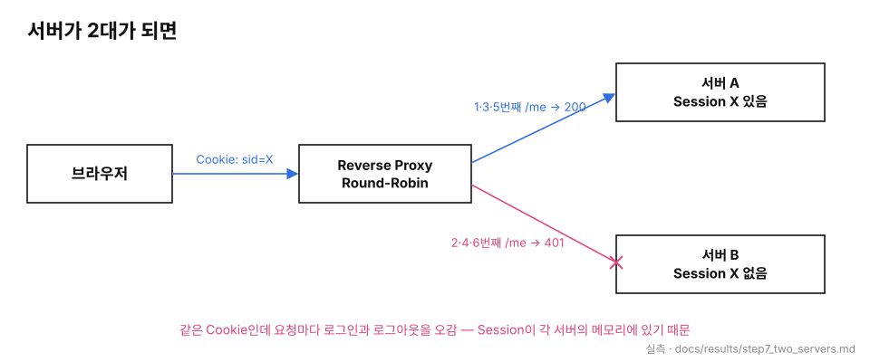

# MicroHTTP — C로 만드는 학습용 웹 서버

## 기본 과제 달성 현황 (STEP 0 베이스라인, 2026-11-25)

인증 기능을 넣기 **전** 상태입니다. 베이스라인에서 발견한 TSan 레이스 1건은 STEP 1 전에 고쳤고, 표는 수정 후 상태입니다(성능은 수정 전후 차이 없음). 이후 모든 비교와 회귀 검증의 기준점입니다. 측정 방법과 원시 결과는 [EXPERIMENT_REPORT.md](EXPERIMENT_REPORT.md) STEP 0에 있습니다.

| 영역 | LMS 체크리스트 항목 | 상태 | 근거 (코드 / 테스트) |
|---|---|---|---|
| 소켓 | `socket → bind → listen → accept`, `SO_REUSEADDR`, bind 실패 처리 | ✅ | `server.c` `create_listener`, `main` |
| 소켓 | 블로킹 + 타임아웃(클라이언트), 논블로킹 connect + poll(백엔드) | ✅ | `net.c` `set_socket_timeout`, `connect_with_timeout` |
| HTTP | 요청 줄·헤더·본문 경계, `Content-Length`, GET/POST | ✅ | `http.c` `http_parse_request`, `test_http.c` |
| HTTP | keep-alive, 파이프라이닝, 연결당 100요청, 유휴 5초 | ✅ | `server.c` `handle_connection`, 기능 테스트 4개 |
| HTTP | 정적 파일, MIME, 404/403/500, 경로 탈출 방지 | ✅ | `static_file.c`, `test_static.c`, `test_mime.c` |
| HTTP | 오류 응답 400/408/411/413/414/417/431/501/505 | ✅ | `test_http.c`, `edge_probe.py` 30케이스 |
| 동시성 | 스레드 풀(기본 8) + 작업 큐(64) + 배압 | ✅ | `server.c` `queue_push`/`queue_pop`/`worker_main` |
| 동시성 | SIGINT/SIGTERM 안전한 셧다운, SIGPIPE 무시 | ✅ | `test_graceful_shutdown_…`. 베이스라인에서 TSan이 `stop_requested` 데이터 레이스를 보고 → C11 `atomic_int`로 수정 (EXPERIMENT_REPORT STEP 0-1) |
| Proxy | Reverse Proxy, 경로 라우팅(최장 prefix), Round-Robin | ✅ | `proxy.c`, `test_proxy.c` |
| Proxy | 502(연결 불가)/504(타임아웃), 장애 백엔드 건너뛰기, 떠난 클라이언트 감지 | ✅ | 기능 테스트 10개 |
| Proxy | Forward Proxy | ➖ | 요구사항은 "최소 한 가지" — Reverse Proxy 선택 |
| 메모리·안정성 | ASan + UBSan | ✅ | `make asan` 단위 6 + 기능 34/34 (인증 추가 후) |
| 메모리·안정성 | ThreadSanitizer | ✅ | `make tsan` 기능 34/34 (인증 추가 후, macOS). 베이스라인은 27/28 → 레이스 수정 후 28/28 |
| 메모리·안정성 | Valgrind(누수·잘못된 접근), 일반 사용자 테스트, malloc 실패 → 500 (Linux) | ✅ | `tests/linux/verify.sh` → `ALL LINUX CHECKS PASSED` |
| 메모리·안정성 | fd 누수 | ✅ | 부하 측정 전후 fd 7 → 7, Valgrind `--track-fds` 종료 시 stdio + 로그만 열림 |
| 메모리·안정성 | 엣지 케이스(불완전 헤더, Slowloris, 큰 본문, 긴 URI, 백엔드 타임아웃, 갑작스러운 종료) | ✅ | `edge_probe.py` 30/30, 기능 테스트 34/34 |

**베이스라인 성능** (hey, 3회 중앙값, M1 Pro 루프백, 작업 스레드 8)

| 시나리오 | 요청/초 | p95 ms | p99 ms | 비정상 응답 |
|---|---:|---:|---:|---:|
| 정적 `GET /`, keep-alive, 동시 8 | 37,700 | 0.3 | 0.6 | 0 |
| 정적, keep-alive, 동시 50 | 39,471 | 0.3 | 4.7 | 0 |
| 정적, 요청마다 새 연결, 동시 10 | 18,248 | 0.9 | 1.2 | 0 |
| 정적, 요청마다 새 연결, 동시 50 | 19,096 | 4.4 | 5.3 | 0 |
| 프록시 `GET /api/x`, 동시 10 | 5,365 | 2.2 | 2.9 | 0 |


외부 HTTP 라이브러리 없이 POSIX 소켓 API만으로 만든 HTTP/1.1 웹 서버입니다.
구현 범위는 [REQUIREMENTS.md](REQUIREMENTS.md), 작업 원칙은 [CLAUDE.md](CLAUDE.md)를 따릅니다.

---

# HTTP는 나를 기억하지 못한다
### C 웹 서버에 Cookie · Session 인증을 직접 만들며 내린 선택들

> 이 글은 "로그인 기능을 만들었다"는 기록이 아니라, **무엇을 발견했고 왜 그렇게 판단했는지**의 기록입니다.
> 모든 숫자는 실제로 실행한 결과이고(원시 결과: [docs/results/](docs/results/)), 측정하지 않은 것은 따로 표시했습니다.
> 그림 오른쪽 아래의 **개념도 / 실측** 표시로 둘을 구분합니다.

## 들어가며 — 로그인은 매일 하는데

우리는 하루에도 몇 번씩 로그인합니다. 그런데 HTTP는 **Stateless**입니다. 요청 하나하나가 독립적이라, 방금 비밀번호를 확인한 서버도 다음 요청에서는 "당신이 누구인지" 모릅니다.

그렇다면 서버는 어떻게 나를 기억할까? 이 질문 하나로 시작했고, 답을 찾아가며 네 가지 문제를 차례로 만났습니다.

| 문제 | 한 줄 질문 |
|---|---|
| 식별 | 무엇으로 사람을 알아볼까? |
| 신뢰 | 클라이언트가 보낸 값을 믿어도 될까? |
| 공유 | 여러 스레드가 같은 Session을 만지면? |
| 수명과 규모 | 언제 잊고, 서버가 늘어나면 어떻게 될까? |



MicroHTTP는 main 스레드가 연결을 받아 작업 큐에 넣고, 작업 스레드 8개가 꺼내 처리하는 **스레드 풀** 서버입니다. 여기에 `auth.c`(로그인 · 로그아웃 · `/me`)와 `session.c`(서버 측 Session 저장소)를 더했습니다.

---

## 1. 무엇으로 사람을 알아볼까 — TCP 연결 ≠ Session

### 처음 떠오른 생각
"로그인에 성공한 **연결**을 기억해 두면 되지 않을까?" 서버 입장에서 가장 손에 잡히는 식별자는 소켓의 fd 번호입니다.

### 가설
TCP 연결은 요청 몇 개 뒤에 닫히고, 커널은 닫힌 fd 번호를 **다음 연결에 바로 다시 줍니다.** 그렇다면 fd로 사람을 기억하는 순간 다른 사람이 그 번호를 물려받을 것입니다.

### 실험
일부러 fd로 사용자를 기억하는 서버(`build/server_fd_demo`)를 만들고, 올바른 서버와 같은 시나리오를 돌렸습니다. 요청마다 새 연결을 쓰고, 서버 로그상 세 연결 모두 **fd 5**를 받았습니다.


| 단계 | Session ID 방식 | fd 방식 |
|---|---|---|
| A가 로그인 (연결 종료) | 303 | 200 |
| **B가 아무 자격 증명 없이 `/me`** | **401** | **200 `user: alice`** |
| A가 새 연결로 `/me` | 200 (Cookie) | 200 (우연히 같은 fd) |

### 배운 것
fd는 "지금 이 순간의 연결 번호"일 뿐, 사람을 가리키지 않습니다. 반대로 연결이 닫힐 때 fd 기록을 지우면 이 사고는 막히지만, A가 새 연결로 오는 순간 로그인이 풀립니다. **어느 쪽이든 연결은 식별자가 될 수 없습니다.**

그래서 로그인에 성공하면 서버가 추측할 수 없는 **Session ID**를 만들어 저장소에 넣고, `Set-Cookie`로 브라우저에 맡깁니다. 이후 브라우저는 어떤 연결로 오든 `Cookie: sid=…`를 들고 옵니다. 한 keep-alive 연결 안에서도 요청마다 Cookie로 판단하므로, 같은 연결에서 alice와 bob이 번갈아 와도 각자로 응답합니다(`test_auth_is_per_request_not_per_connection`).

---

## 2. 클라이언트가 보낸 값을 믿지 않기

Cookie는 클라이언트가 마음대로 고칠 수 있습니다. 그래서 Cookie에는 **상태를 담지 않고 열쇠(ID)만** 담습니다. 진짜 상태(누가 로그인했는가)는 서버 메모리에만 있습니다.


| 선택 | 이유 |
|---|---|
| Session ID = CSPRNG 256비트(16진수 64자) | 순번·시각·사용자 이름으로 만들면 남의 ID를 추측할 수 있음 |
| 형식 검사 → 상수 시간 비교(`sodium_memcmp`) | 형식이 틀린 값은 저장소를 뒤지기 전에 거절, 비교 시간으로 ID가 새지 않게 |
| 로그인할 때마다 새 ID, 이전 ID 폐기 | 공격자가 미리 심어 둔 ID가 로그인 후에도 살아 있는 Session 고정 공격 방지 |
| 비밀번호는 argon2id 해시로만 비교 | **직접 구현하지 않고** 검증된 라이브러리 libsodium 사용 (과제 금지 목록인 HTTP/이벤트 루프 라이브러리와 무관) |
| `HttpOnly; SameSite=Lax; Path=/` | JavaScript로 ID를 읽지 못하게, 다른 사이트에서 시작된 POST에 Cookie가 실리지 않게 |
| 로그에 Session ID를 남기지 않음 | 로그도 유출 경로. 프록시·백엔드 로그에서 64자 ID 0건 확인 |

`user=alice; logged_in=true; role=admin`처럼 상태를 담은 위조 Cookie, 한 글자 바꾼 ID, 형식만 맞춘 ID, 로그아웃한 ID는 모두 401입니다.

> **한계**: HTTPS와 Cookie 속성은 **이미 탈취된** Session ID의 재사용을 막지 못합니다. 이 서버는 아직 HTTP만 지원해서 `Secure` 속성도 붙이지 못했습니다(붙이면 브라우저가 HTTP로는 Cookie를 보내지 않음).

---

## 3. 여러 스레드가 같은 Session을 만질 때 — Use-After-Free

### 문제
Session 저장소는 이 서버에서 처음 생긴 **"여러 스레드가 동시에 읽고 지우는"** 공유 자원입니다. 한 스레드가 `/me` 응답을 만드는 동안 다른 스레드가 같은 Session을 로그아웃(`free`)하면 어떻게 될까요?

### 가설과 실험
조회 결과를 노드 안의 **포인터**로 넘기면, 락을 푼 뒤 응답을 만드는 사이에 노드가 해제되어 해제된 메모리를 읽을 것입니다. 읽는 스레드(조회 → 락 밖에서 200us 응답 생성)와 쓰는 스레드(로그아웃 → 재로그인)를 3,000번씩 경쟁시켰습니다(`tests/experiments/step2_uaf.c`).



| 도구 | 포인터를 넘기면 | 복사해서 넘기면 |
|---|---|---|
| ASan | **heap-use-after-free** — `session_destroy`가 free한 메모리를 `snprintf`가 읽음 | 0건 |
| Valgrind | **Invalid read 4건** | 0건 |
| TSan | **잡지 못함** | 0건 |

### 선택
**락 안에서는 값을 독립된 메모리(`SessionInfo`)로 복사만 하고, 느린 일(응답 생성, `send`)은 락 밖에서** 합니다. 진행 중인 요청은 조회 시점의 **스냅샷**으로 끝까지 응답하고, 그다음 요청부터 401이 됩니다.

### 의외의 발견
TSan은 이 UAF를 잡지 못했습니다. 해제된 메모리를 읽는 곳이 libc `snprintf` 안이라 계측 범위 밖일 가능성이 있습니다(미검증 가설). **"TSan이 깨끗하다 = 메모리가 안전하다"가 아니라는 것**, 그래서 도구를 여러 개 겹쳐 써야 한다는 것을 배웠습니다.

---

## 4. 락은 어디까지 쥘 것인가

복사로 UAF를 막았다면, 차라리 **응답을 보낼 때까지 락을 쥐고 있으면** 더 간단하지 않을까요? 두 방식을 같은 조건(같은 기계, `GET /me` 20,000회, keep-alive, 3회 반복)에서 비교했습니다. 두 빌드 모두 락 통계 계측을 켜서 계측 비용도 같게 맞췄습니다.


- **동시 8**: 넓은 락이 약 **14% 느렸고**, 3회 범위가 겹치지 않아 실제 차이로 판단했습니다. 작업 스레드 8개가 모두 일하는 상황에서 한 스레드가 `send`하는 동안 나머지 7개가 락을 기다립니다.
- **동시 50**: **차이가 없었습니다.** 연결 50개가 스레드 8개를 기다리는 구조라 병목이 락보다 앞단(스레드 풀 대기)에 있고, 락 대기는 그 시간에 묻힙니다.
- 락 점유 시간은 **34배**(0.21us → 7.26us), 대기 시간은 **29배** 차이가 났습니다.

"차이가 없다"도 결과입니다. 루프백에서 150바이트 응답의 `send`는 몇 마이크로초면 끝나기 때문입니다. **느린 클라이언트**라면 넓은 락은 그 클라이언트 하나 때문에 모든 사용자의 인증을 멈추게 할 것입니다 — 이 시나리오는 측정하지 않았습니다.

---

## 5. 언제 잊을 것인가 — 만료

Session을 영원히 기억하면 탈취된 ID도 영원히 유효하고, 다시 오지 않는 사용자의 Session이 메모리에 쌓입니다.

| 선택 | 내용 |
|---|---|
| Idle Timeout (`-I`, 기본 30분) | 마지막 사용 후 일정 시간 |
| Absolute Timeout (`-A`, 기본 8시간) | 계속 써도 생성 후 일정 시간 |
| Passive Expiration | 조회할 때 만료를 **먼저** 검사 → 만료면 갱신하지 않고 그 자리에서 삭제 |
| Active Expiration | 요청이 없어도 1초마다 저장소를 훑어 삭제 |

**설계상 고민**: 원래 지침은 "기존 이벤트 루프를 활용한 주기적 정리"였지만, 이 서버는 이벤트 루프가 없는 스레드 풀 구조입니다. 새 스레드를 만드는 대신, **이미 1초마다 깨어나는 main의 accept 루프(`poll(1000ms)`)를 타이머로** 썼습니다. 대신 큐가 가득 차 main이 기다리는 동안은 정리도 늦어진다는 한계를 기록했습니다.

**실측**: `-I 3`으로 Session 6개를 만들고 bob만 2초에 한 번 사용 → **요청이 하나도 없는데** 로그에 `expired 2, remaining 4` → `expired 3, remaining 1` → `expired 1, remaining 0`, 이후 bob의 `/me`는 401.



TTL은 짧을수록 탈취된 ID의 수명이 줄지만(Security), 자주 다시 로그인해야 합니다(Usability). 위 그림은 **개념도**이며 교점을 최적값으로 단정하지 않습니다.

| 서비스 성격 | Idle | Absolute | 이유 |
|---|---|---|---|
| 금융·공공 (예: 고용24) | 짧게 + 연장 버튼 | 짧게 | 피해가 크고 공용 PC가 많음. 고용24는 남은 시간과 연장 버튼을 보여 주는 **UI 사례로만** 참고(내부 구현·최적성은 미확인) |
| 사내 업무 도구 | 수십 분 | 근무 시간 | 보안과 업무 흐름의 균형 |
| 커뮤니티·쇼핑 | 길게 | 길게 + 중요 작업 시 재인증 | 재로그인 피로가 이탈로 이어짐 |

---

## 6. Reverse Proxy를 거쳐도 같을까



같은 C 서버를 백엔드로 하나 더 띄우고, 앞 서버가 `/login`·`/logout`·`/me`를 넘기게 했습니다. 프록시는 `Cookie`를 hop-by-hop 헤더가 아닌 일반 헤더로 그대로 전달하고, 백엔드의 `Set-Cookie`·`Cache-Control: no-store`를 해석 없이 중계하므로 **직접 접근과 결과가 모두 같았습니다.**
프록시에는 캐시가 없어서(없으면 새로 만들지 않는다는 원칙) 프록시 자체의 캐시 오염 위험은 없고, `no-store`는 브라우저와 중간 캐시를 위한 것입니다. 단, 백엔드가 이 헤더를 빠뜨려도 프록시가 보완하지는 않습니다. 프록시~백엔드 구간은 **평문**입니다.

---

## 7. 서버가 2대가 되면



A에서 받은 Session ID로 B에 가면 401입니다. 두 서버를 Round-Robin 프록시 뒤에 두면 같은 Cookie로 `/me`가 **200, 401, 200, 401…**을 오갑니다. Session이 각 서버의 메모리에 있기 때문입니다. 해결책은 비교까지만 하고 구현하지 않았습니다.

| 방식 | 장점 | 단점 |
|---|---|---|
| Sticky Session | 서버 코드 변경 없음 | 그 서버가 죽으면 로그인 유실, 부하 쏠림 |
| Session Replication | 어느 서버로 가도 됨 | 복제 지연·충돌, 통신량 증가 |
| 공유 저장소 (Redis 등) | 서버가 상태를 갖지 않아 확장 쉬움 | 저장소가 단일 장애점, 요청마다 네트워크 왕복 |

---

## 8. 기존 서버를 망가뜨리지 않았나 — 회귀

인증을 넣기 **전**에 성능과 새니타이저 결과를 기준점(STEP 0)으로 남겨 두고, 같은 스크립트로 다시 측정했습니다.

| 검사 | 인증 전 | 인증 후 |
|---|---|---|
| `make test` / `asan` / `tsan` | 28/28 | **34/34** (인증 테스트 6개 추가) |
| Linux `verify.sh` (Valgrind, 일반 사용자, malloc 실패 주입) | ALL PASSED | **ALL PASSED** (+ Valgrind 아래 인증 흐름) |
| 정적 keep-alive c8, **같은 시간대 A/B 교차 6회** | 35,599 요청/초 | **37,884 요청/초** |

**측정의 함정**: 처음에는 인증 전후를 따로 측정해서 keep-alive 처리량이 **-31%**로 나왔습니다. 정적 경로에 추가된 건 문자열 비교 3번뿐이라 이상했고, 두 바이너리를 같은 시간대에 번갈아 측정하자 오히려 같거나 빨랐습니다. 같은 세션 안에서도 두 바이너리가 함께 31k → 40k로 움직였으니, -31%는 **측정 시점의 환경 차이**였습니다. "숫자가 나쁘게 나왔다"에서 멈추지 않고 비교 방법을 의심한 것이 이번 과제에서 가장 크게 배운 점 중 하나입니다.

---

## 9. 그 과정에서 발견하고 고친 것들

| 발견 | 원인 | 판단 |
|---|---|---|
| TSan 첫 실행에서 데이터 레이스 | `volatile sig_atomic_t`를 작업 스레드도 읽음 (시그널 안전 ≠ 스레드 안전) | 인증 작업 **전에** lock-free `atomic_int`로 수정 → 이후 TSan 결과를 깨끗하게 읽기 위해 |
| 프록시 "클라이언트 이탈" 오탐 (1000건 중 116건 `status=-1`) | 응답을 다 받은 클라이언트가 백엔드 EOF보다 먼저 닫음 | 아무것도 중계하지 않았을 때만 중단으로 처리 |
| `Cookie` 헤더를 못 찾음 | 대소문자 무시 비교가 한쪽만 소문자로 바꿈 | 양쪽 모두 소문자로 비교 |
| 로그아웃 실험이 실패 | `curl -X POST`가 Content-Length를 안 보내 **411** | 서버 규칙이 맞고 스크립트가 틀림 → 스크립트 수정 |
| Valgrind에서 테스트가 11분 넘게 안 끝남 | 만료 스레드가 쉬지 않고 돌아 다른 스레드가 굶음 | 실제 서버처럼 쉬어 가며 훑도록 테스트 수정 |
| 인증 후 처리량 -31% | 측정 시점의 환경 차이 | A/B 교차 측정으로 회귀 없음 확인 |

---

## 한계와 미완료

| 항목 | 상태 |
|---|---|
| TLS(HTTPS) 종료, HTTP vs HTTPS 비교, 탈취 ID 재사용 실험 | **미완료** — 방식 결정·검증 시간 부족. 프록시~백엔드 구간은 평문 |
| CSRF 보호 범위 검증 | **미완료** — SameSite=Lax만 적용 |
| Cookie `Secure` | 미적용 (HTTP만 지원) |
| 느린 클라이언트에서의 락 범위 비교 | 미실행 |
| Session이 많을 때 연결 리스트 조회 비용 | 미측정 (성능 측정은 Session 1개 상태) |
| 로그인 실패 응답 시간 | 없는 사용자는 해시 검증을 건너뛰어 빠름 → 사용자 존재 여부가 드러날 수 있음 |

## 마치며 — 이 코드의 본질

**연결은 사라지지만, 사람은 남는다.**

로그인 기능은 결국 Stateless 프로토콜 위에 서버가 상태를 얹는 일이었고, 그 대가는 네 가지였습니다.

1. **식별** — 상태를 무엇에 묶을 것인가 (연결이 아니라 ID)
2. **신뢰** — 클라이언트 값은 열쇠일 뿐 상태가 아니다
3. **공유** — 여러 스레드가 만지는 상태는 복사해서 들고 나간다
4. **수명과 규모** — 상태는 잊어야 하고, 서버가 늘면 상태를 어디에 둘지가 다시 문제가 된다

## 재현 명령어

```bash
make server build/hashpw build/server_fd_demo
./server -p 8080 -U tests/functional/users.txt                 # 테스트 계정: alice / alice-test-pw
python3 tests/experiments/step1_fd_reuse.py                     # 1. fd vs Session
python3 tests/functional/test_server.py auth                    # 2. 위조 Cookie 등 인증 테스트
make build/step2_uaf CFLAGS='-O1 -g -fsanitize=address' LDFLAGS=-fsanitize=address && build/step2_uaf unsafe   # 3. UAF
sh tests/bench/step2_lock_scope.sh 3                            # 4. 락 범위
sh tests/experiments/step3_proxy_auth.sh                        # 6. 프록시 경유
sh tests/experiments/step7_two_servers.sh                       # 7. 서버 2대
sh tests/bench/baseline.sh 3                                    # 8. 성능 회귀
python3 tools/draw_diagrams.py                                  # 이 문서의 그림 다시 그리기
```

자세한 기록: [EXPERIMENT_REPORT.md](EXPERIMENT_REPORT.md) · 변경 파일과 선택 근거: [IMPLEMENTATION_REPORT.md](IMPLEMENTATION_REPORT.md) 10절 · 호출 흐름: [CODE_FLOW.md](CODE_FLOW.md) 2.4 · 발표 질의응답 대비: [STUDY_GUIDE.md](STUDY_GUIDE.md) 13~16절


---

## 문서와 실행 방법

| 문서 | 내용 |
|---|---|
| [CODE_FLOW.md](CODE_FLOW.md) | 서버 실행부터 종료까지, 연결부터 응답까지의 함수 호출 순서 |
| [STUDY_GUIDE.md](STUDY_GUIDE.md) | 핵심 개념 12개를 What/Why/How/Without/Code로 정리 + 확인 질문 |
| [IMPLEMENTATION_REPORT.md](IMPLEMENTATION_REPORT.md) | 요구사항별 구현 상태, 테스트 명령어와 실제 결과, 한계 |
| [QUALITY_REPORT.md](QUALITY_REPORT.md) | 품질 기준(단위·기능·부하·메모리·엣지 케이스)별 검증 결과와 발견·수정한 결함 |
| [EXPERIMENT_REPORT.md](EXPERIMENT_REPORT.md) | 인증 과제 실험 기록 (STEP 0 베이스라인부터) |

## 빌드와 실행

```sh
make
./server -p 8080 -r ./www
```

브라우저에서 <http://127.0.0.1:8080/>을 엽니다. 종료는 Ctrl+C입니다.

| 옵션 | 의미 | 기본값 |
|---|---|---|
| `-p port` | 리스닝 포트 | 8080 |
| `-r root` | 정적 파일 루트 디렉터리 | `./www` |
| `-t threads` | 작업 스레드 수 (스레드 풀) | 8 |
| `-R prefix=host:port[,host:port...]` | Reverse Proxy 규칙 (여러 번 지정 가능) | 없음 |
| `-b address` | 바인딩할 IPv4 주소 | `127.0.0.1` |
| `-v` | 파서/수신 상세 로그 | 끔 |

## Reverse Proxy 실습

```sh
python3 tools/backend.py 9001 A &     # 실습용 백엔드 (Python 표준 라이브러리)
python3 tools/backend.py 9002 B &
./server -R /api/=127.0.0.1:9001,127.0.0.1:9002
curl http://127.0.0.1:8080/api/hello  # A, B가 번갈아 응답 (Round-Robin)
```

`/api/`로 시작하는 요청은 백엔드로 전달하고, 나머지는 정적 파일로 응답합니다.
연결할 수 없는 백엔드는 건너뛰며, 모두 실패하면 502, 응답이 5초 동안 없으면 504입니다.

## 테스트

```sh
make test   # 단위 테스트(tests/unit) + 기능 테스트(tests/functional)
make asan   # AddressSanitizer/UBSan 빌드로 전체 테스트
sh tests/functional/curl_check.sh   # curl로 정적 파일·프록시 확인
python3 tests/functional/edge_probe.py <port>   # 떠 있는 서버에 엣지 케이스 30개 (사용법은 파일 머리말)
docker build -t microhttp-verify tests/linux && docker run --rm -v "$PWD":/src:ro microhttp-verify sh /src/tests/linux/verify.sh   # Linux: 일반 사용자 테스트, Valgrind, malloc 실패 주입
```

## 소스 구조

| 파일 | 역할 |
|---|---|
| `src/server.c` | main, 리스너, 스레드 풀(작업 큐), 시그널 셧다운, 연결 처리(keep-alive), 요청 처리 |
| `src/http.c` | HTTP 요청 파서, 응답 헤더 생성 (소켓 I/O 없음) |
| `src/static_file.c` | 루트 안에서 파일 찾기(403/404), MIME 타입 매핑 |
| `src/proxy.c` | Reverse Proxy: 경로 라우팅, Round-Robin, 요청 재작성, 응답 중계, 502/504 |
| `src/session.c` | 서버 측 Session 저장소: 생성·조회(복사본)·삭제·만료, mutex 하나 |
| `src/auth.c` | `/login`·`/logout`·`/me`, Cookie·폼 파싱, 비밀번호 확인(libsodium) |
| `src/net.c` | `send_all`, 소켓 타임아웃, 타임아웃 있는 connect, 오류 응답 송신 |
| `tools/backend.py` | 프록시 실습용 백엔드 (테스트 도구) |
